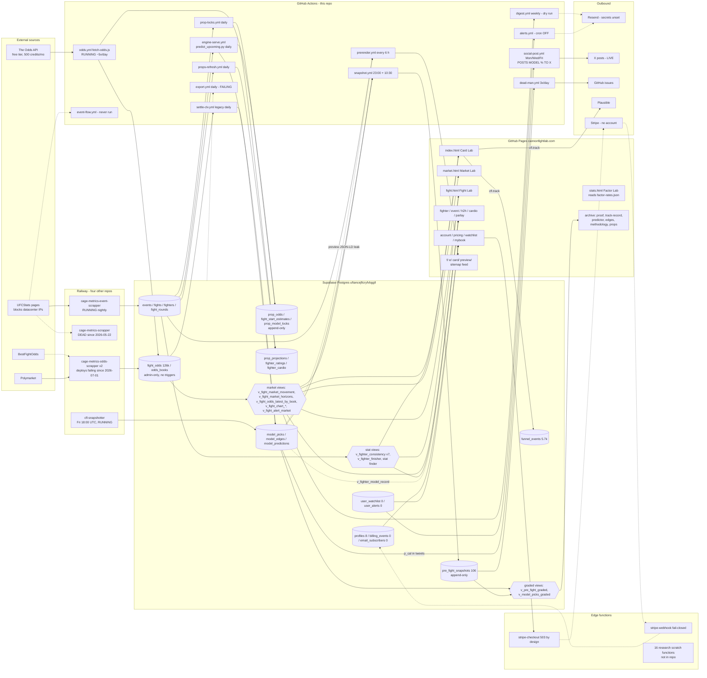

# 02 — System architecture and technical inventory

Audit date: 2026-10-12. Repository `cannhaven-wq/Cage-Metrics` at `origin/main` `5aed9e42`. Live state verified through read-only access to the Supabase project, the Railway workspace, and the GitHub Actions run history. Tags: **VERIFIED**, **INFERRED**, **UNKNOWN**. Classification scale: PRODUCTION READY / FUNCTIONAL BUT INCOMPLETE / PROTOTYPE / BROKEN / PLANNED ONLY / UNKNOWN. "Running" means a scheduled job produced its expected output within its last cycle, checked in the live system; "exists" means the code is in the repo.

## 1. One-screen summary

| component | classification | one line |
|---|---|---|
| Static site (31 root pages, 13 shared JS modules, 1 CSS) on GitHub Pages | FUNCTIONAL BUT INCOMPLETE | The four product surfaces are coherent and tested; one product page still renders model output; four pages carry stale copy. |
| Prerendered stubs (`f/` 4,554, `e/` 801, `card/` 7, `preview/` 75) | FUNCTIONAL BUT INCOMPLETE | SEO pipeline works and drives nearly all traffic; 14 of 75 preview pages ship a "models pick X" FAQ in JSON-LD, which the rules forbid. |
| Supabase Postgres (38 tables, 61 views, 17 functions) | FUNCTIONAL BUT INCOMPLETE | Core table DDL lives in other repos; three CLV migrations unapplied; two tables with RLS off; 10 orphan tables. |
| Supabase edge functions (18 deployed, 2 in repo) | FUNCTIONAL BUT INCOMPLETE | Stripe checkout and webhook fail closed by design; 16 research scratch functions are deployed and untracked. |
| Odds capture (`build/fetch-odds.js`, `odds.yml`) | FUNCTIONAL BUT INCOMPLETE | Running 4–6 times a day; credit governor pinned at its coarsest rung because its ledger table is unapplied. |
| Railway scrapers (4 repos, 6 projects) | MIXED | Event scraper running nightly; fighter scraper dead since May; odds scraper's every deploy since July has failed. |
| Python engine (`cfl_engine/`) and research lines | FUNCTIONAL BUT INCOMPLETE | Runs daily, writes a private record; nothing it produces beats the market; CLV-001 scores nothing. |
| Pre-fight record and dead man's handle | FUNCTIONAL BUT INCOMPLETE | Working since 2026-08-15; one card permanently lost; watchdog cannot see its own silence. |
| Email (digest, alerts, dead-man mail) | PLANNED ONLY in production | Code complete; `RESEND_*` unset; alerts cron commented out; zero subscribers. |
| Social auto-poster | **BROKEN against product rules** | Posts model percentages to X three times a week; verified from the 2026-10-09 run log. |
| Auth, entitlements, billing | FUNCTIONAL BUT INCOMPLETE | Entitlement decided in Postgres; nothing gated; no Stripe account; checkout 503 by design. |
| Analytics (`cfl.track`, Plausible) | PRODUCTION READY (narrow) | 24 event names, three copies kept in sync by a test; privacy page does not name Plausible. |
| Tests and CI | PRODUCTION READY as a tripwire suite | 629 Python tests and 17 Node files pass locally and on every push. |
| Documentation and coordination layer | FUNCTIONAL BUT INCOMPLETE | Extensive; a dozen stale claims; `HANDOFF.md` preamble corrupted. |

## 2. Architecture diagram

Dotted lines are paths that exist in code but are not delivering today.

## 3. Frontend

**Stack.** Plain HTML/CSS/JS, no bundler, one stylesheet (`_shared.css`, 1,426 lines). Every page loads `@supabase/supabase-js@2.106.1` from jsDelivr with an SRI hash, then `_shared.js`, then `_auth.js` (VERIFIED on all 29 non-stub pages). `_shared.js:26` keeps the no-op auth lock. Cache-busting is inconsistent: 29 pages load `_shared.js?v=rl3`, `watchlist.html` loads `?v=rl4` and `_auth.js?v=rl2`, `mybook.html` loads `_auth.js?v=mybook1`.

**Pages (31).** Product: `index.html` (Card Lab), `market.html`, `fight.html`, `stats.html`, `event.html`, `fighter.html`, `fighters.html`, `h2h.html`, `cardio.html`, `parlay.html`. Archive (banner): `proof.html`, `track-record.html`, `predictor.html` (noindex, orphan), `edges.html`, `methodology.html`, `props.html` (noindex, orphan). Member: `pricing.html`, `account.html`, `login.html`, `signup.html`, `reset.html`, `mybook.html` (gated), `watchlist.html` (gated), `unsubscribe.html`. Static: `about.html`, `contact.html` (Formspree), `disclaimer.html`, `privacy.html`. Internal: `lab.html` (noindex; reads admin-only tables with the anon key, so its odds comparison is silently empty). Stubs: `card-lab.html`, `picks.html` (both single-hop meta-refresh to `/`). Full per-page matrix in `03_FEATURE_INVENTORY.md`.

**Shared modules (13).** `_shared.js` (client, nav, formatters, `fetchAll`, `orderCard`, `cfl.track`), `_auth.js`, `market.js` (every market number's wording), `market-chart.js`, `market-movement.js`, `fight-insights.js`, `edges.js` (retired verdict logic, kept for the snapshotter), `distanceEdges.js` (loaded by no page), `entitlements.js` (`CHECKOUT_BLOCKERS`, `SURFACES` all `enforced:false`), `billing-lifecycle.js`, `alerts.js`, `watchlist-ui.js`, `proof-gates.js`.

**Prerendered output.** `build/prerender.js` on a 6-hour cron writes 4,554 fighter stubs, 801 event stubs, 7 card pages, 75 fight previews, `sitemap.xml` (5,452 URLs) and `feed.xml`, committing as `github-actions[bot]`. `card/` pages are pick-free. `preview/` pages void the rendered pick line but still build a `FAQPage` JSON-LD answer "Cannon Fight Lab's models pick ${winnerName} … beat the opening price" (`build/preview-templates.js:162-172`); 14 of 75 shipped files contain it (VERIFIED by grep). The no-model test scans only root pages.

## 4. Backend

### 4.1 Supabase (project `uftancejftcryfvbggll`, us-east-2, Postgres 17.6, created 2026-04-26)

- 38 tables, 61 views, 17 functions in `public`. Live counts are in `04_DATA_AND_MODELS.md` §A1.
- **No DDL in this repo** for `events`, `fighters`, `fights`, `fight_rounds`, `fight_odds`, `odds_books`, `profiles`, `premium_waitlist`, `model_predictions`, `model_versions`, `prediction_indicators`, `predictions`, `prop_odds` (base), `hub_visits`, nor for `v_fighter_style`, `v_predictions_with_results`, `v_event_accuracy`, `current_user_is_admin()`. Ten live tables are defined nowhere in the repo at all (`streak_effect_cache`, `cardio_style_snapshots`, `master_dataset`, `master_dataset_v2`, `fighter_snapshot_2025`, `prediction_indicators`, `fight_odds_consensus_snapshot`, `hub_visits`, `odds_aliases`, `unmatched_odds`).
- Migration log: 24 entries, all 2026-09-14 → 2026-09-21. Everything before was applied by hand through the SQL editor; the 34 root `*.sql` files carry applied-state only in prose, 7 with a dated header.
- Unapplied by the project's own record: `research/clv/proposed_2026-09-16_event_flow.sql` (creates `odds_api_usage`, `fight_bout_order`, `fight_bout_completions`), `_fight_odds_immutability.sql`, `_clv001_columns.sql`, `_snapshot_edge_identity.sql`, `cfl_engine/integrity/count_rpc.sql`. VERIFIED absent live.
- Access model: public read on fight data and all `v_*` views for `anon` and `authenticated`; `fight_odds` and `odds_books` locked to admin (VERIFIED live policy `private_lockdown_admin_only`), reached only through 38 `SECURITY DEFINER` views; member tables owner-scoped; `funnel_events` insert-only; `billing_events` service-role only. Advisor findings in `04_` §A7.
- Hazard: `public_read_odds.sql` at the repo root would grant anon `SELECT` on `fight_odds` if applied; nothing marks it superseded.

### 4.2 Edge functions

Deployed: 18. In repo: `stripe-checkout` (returns 503 `checkout_disabled` naming T-054/T-048 before authenticating; then 503 `not_configured` without Stripe secrets) and `stripe-webhook` (signature check is the authentication; dedupe-first insert on `stripe_event_id`; fails closed without `STRIPE_WEBHOOK_SECRET`). Both have `verify_jwt=false` live (VERIFIED via the management API) but that setting is recorded nowhere in the repo. The other 16 (`prop0002-runner`, `prop0003-*`, `cfl-pyodide-test`, `cfl-webr-test`, `cfl-prop0001-repro`, `cfl-cardio-fold-fit`, …) are research scratch created around 2026-09-14, all ACTIVE, `verify_jwt=true`, with no source in any repo.

### 4.3 Scheduled jobs — GitHub Actions (19 workflows, 3,127 total runs)

| workflow | schedule | permissions | live status (VERIFIED run history) |
|---|---|---|---|
| `tests.yml` | push, PR | read | passing; 143 runs |
| `odds.yml` Fetch UFC odds | asks `*/5`; delivered 4–6×/day | read | success, last 2026-10-12 06:53 |
| `snapshot.yml` | 23:00 and 10:30 UTC | default | success |
| `dead-man.yml` | 21:15, 00:10, 12:00 UTC | read + issues | success; has never needed to open an issue |
| `engine-serve.yml` | 09:00 UTC | default | success daily |
| `props-refresh.yml` | 10:00 UTC | default | success daily (feeds an archived page) |
| `prop-locks.yml` | 11:00 UTC | default | success daily |
| `settle-clv.yml` | 12:00 UTC | default | success daily, legacy mode only |
| `prerender.yml` | every 6 h | write | success; 597 bot commits |
| `digest.yml` | Wed 15:00 UTC | read | success, but dry-run (no `RESEND_API_KEY`) and 0 subscribers |
| `social-post.yml` | Mon/Wed/Fri 17:00 UTC | write | success; **posts to X with model percentages** (run 37993596942, 2026-10-09: tweet id 2108670936010387493 "BONFIM 50% over PRADO"); Reddit skipped (secrets missing) |
| `export.yml` | 05:00 UTC daily | write | **failing every day**: `SUPABASE_URL is not set`; `data/` has never been committed |
| `alerts.yml` | **cron commented out** (T-073) | read | 4 manual runs on 2026-09-21 only |
| `event-flow.yml` | **cron commented out** (T-030) | read | 0 runs ever |
| `social-content.yml` | manual | write | 0 runs |
| `factor-rates-validate.yml` | manual, read-only | read | 2 runs 2026-09-18 |
| `validate.yml` | manual | write | last run 2026-05-15 |
| `verify-live.yml` | manual | read | last run 2026-09-21 (passed) |
| `verify-billing-refusal.yml` | manual | read | 1 run 2026-09-21 (passed) |
| Pages build | on push | — | success |

GitHub throttles high-frequency schedules; the repo's own design accounts for this by measuring elapsed time rather than trusting the cron.

### 4.4 Scheduled jobs — Railway (6 projects, VERIFIED via the Railway API)

| project / service | last successful deploy | latest deploy | evidence of running |
|---|---|---|---|
| Event Scraper / Weekly Scraper | 2026-07-14 | SUCCESS | log 2026-10-12 00:05–00:09 UTC: 9 events, 97 fights upserted, 53 fighters refreshed, 0 errors |
| Event Scraper / cage-metrics-event-scrapper | 2026-07-01 | SUCCESS | (second service, same repo) |
| radiant-caring / cage-metrics-scrapper (fighters) | 2026-05-22 | **FAILED 2026-07-01** (the UFCStats proof-of-work fix never deployed) | 4,495 of 4,554 fighters last updated May 2026 |
| model / cage-metrics-odds-scrapper | 2026-05-26 | **FAILED** ×5 since 2026-07-01 | no deploy logs; Polymarket rows still arriving through 2026-10-12 (INFERRED: the May build still runs) |
| skillful-transformation / cage-metrics-odds-scrapper (duplicate service) | 2026-05-26 | **FAILED** ×5 | D-004 notes a dashboard-overridden start command pointing at the retired `backfill_odds.py` that "should be removed" |
| humble-integrity / cfl-snapshotter | 2026-10-05 | SUCCESS | ran 2026-10-09 18:00 UTC, wrote 12 predictions, exited cleanly |
| odds backfill | — | no services | empty project |

Railway plan and spend are not exposed through the API used here (UNKNOWN).

### 4.5 Python engine and research (`cfl_engine/`, `research/`)

`cfl_engine/` (75 files): walk-forward XGBoost engine (`engine.py`, `train.py`, `audit.py`, `faces.py`), serving scripts (`predict_upcoming.py`, `predict_props_upcoming.py`, `export_*.py`), `snapshot_predictions.py`, `settle_clv.py` (1,164 lines; legacy and CLV-001 modes), `clv/` (frozen scoring library, 200 tests), `dur001/` and `dur002/` (duration-model locks and harness), `event_flow/` (UFCStats running-order ledger, 87 tests, never run in production), `features/`, `models/`, `cardio/`, `integrity/` (21 checks, runner needs an unapplied RPC). `requirements.txt` is all `>=` ranges (T-011). `research/` holds the frozen CLV-001 protocol (1,659 lines), five proposed migrations, FE-001 factor evidence, the data-integrity audit, provenance reports, the research register, and the 2026-05 `edges.js` validator. Details and verdicts in `04_DATA_AND_MODELS.md` Part B.

## 5. External integrations

| service | where | credential | status |
|---|---|---|---|
| The Odds API | `build/fetch-odds.js:681` | `ODDS_API_KEY` (set) | active; free tier, hard cap 500 credits/month in code |
| UFCStats | Railway scrapers; `cfl_engine/event_flow` | none | scrapers partly running; blocks datacenter IPs; no terms on file |
| Supabase | everything | publishable key in `_shared.js`; service key in CI | active |
| Resend | `send-digest.js`, `send-alerts.js` | `RESEND_API_KEY`, `RESEND_FROM` | **unset** → dry-run |
| Plausible | 26 of 31 pages, event name only | none | active; not named in `privacy.html` |
| X (Twitter) | `build/social-post.js` | `X_*` | **set and posting** |
| Reddit | `build/social-post.js` | `REDDIT_*` | client id/secret unset → skipped |
| Stripe | edge functions | `STRIPE_*` | unset by design; no account |
| Polymarket, BestFightOdds | odds-scraper repo | — | external |
| Formspree | `contact.html` | form id | unverified |
| Discord | `cfl_engine/dur001/alert.py` | `DISCORD_WEBHOOK_URL` | not wired to any workflow |

## 6. Authentication, entitlements, billing

Sign-up creates a `profiles` row with `beta_premium=true` via a `SECURITY DEFINER` trigger; the browser tier is presentation only; `current_user_is_pro()` is the one server-side gate and **no policy or view calls it yet** (D-019). The `profiles` UPDATE policy pins all eight security columns (VERIFIED live). Checkout: button disabled in served HTML → `CHECKOUT_BLOCKERS` → edge function 503. Webhook → `billing_events` dedupe → entitlement → `profiles` → `v_my_billing` → `account.html`. All built; nothing can take money (no account, no price, no secrets, two legal blockers). Live users: 8 accounts, 0 sign-ins in 30 days.

## 7. Analytics and monitoring

- `cfl.track` → `funnel_events` (insert-only) and Plausible (name only); 24 names pinned across three files by a test. 5,665 events since 2026-09-21; see `05_`.
- Monitoring: the dead man's handle (pre-fight record coverage, 3×/day, opens GitHub issues; no issue has ever been opened), `settle-clv.yml` opens an issue on failure, `verify-live.yml` is manual. No uptime monitor, no error tracking, no alerting outside GitHub for GitHub's own failures (T-076). The `export.yml` failure has been red daily with nobody acting on it — the exact silent-failure pattern the repo documents.

## 8. Testing and CI

- Node: 17 files, ~418 assertions, zero dependencies; all pass (run in this audit).
- Python: 629 passed, 4 skipped, 4,755 subtests, 13 s (run in this audit). Skips: one test needs a Supabase access token (it writes probe rows to production, so CI must never get that secret); three are frozen-protocol state checks.
- CI: `tests.yml` on every push and PR, read-only. Not covered: `build/test-fetch-odds.js` (945 lines of capture tests), preview/card stub output, `social-engine.js` templates, runtime-built `<title>` strings.

## 9. Hosting and deployment

GitHub Pages from `main` (custom domain `cannonfightlab.com`, `.nojekyll`); every push to `main` deploys, including the 6-hourly bot commits. Supabase hosted Postgres plus edge functions. Railway for four scraper/cron services. No staging environment, no preview deploys, no rollback mechanism other than git revert (and the append-only tables cannot be reverted). The live site could not be fetched from this audit's container (egress policy); the repo's own `verify-live.yml` last passed 2026-09-21.

## 10. Dependencies and related repositories

Four repositories are load-bearing and were not inspectable here: `cage-metrics-scrapper` (fighters), `cage-metrics-odds-scrapper` (main `fight_odds` writer, Polymarket, v1–v6 training), `cage-metrics-event-scrapper` (events, fights, results), `cfl-snapshotter` (`predictions`). Their schemas, crons and secrets are UNKNOWN beyond Railway deployment metadata and the writer inventory in `research/clv/FIGHT_ODDS_WRITER_INVENTORY.md`.
